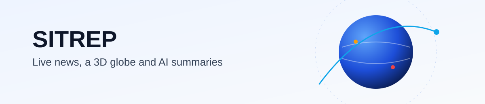

<p align="center">
  
</p>

<p align="center">
  
  
  
  
</p>

<h1 align="center">SITREP: Global Command Center</h1>

<p align="center"><strong>Live news, a 3D globe and AI summaries, in one connected workspace.</strong><br>
A browser dashboard that turns public headlines into a sourced daily brief, answers questions from current stories, and translates them into Greek.</p>

<p align="center">
  <a href="https://ykco-website.vercel.app"><strong>Open the dashboard</strong></a> &nbsp;·&nbsp;
  <a href="#features">Features</a> &nbsp;·&nbsp;
  <a href="#quick-start">Quick start</a> &nbsp;·&nbsp;
  <a href="#configuration">Configuration</a> &nbsp;·&nbsp;
  <a href="#how-it-works">How it works</a>
</p>

## Features

| Feature | What it does |
| --- | --- |
| **Daily brief** | Three or four short points summarising the top headlines. Each point links to the articles it is based on. |
| **Ask the feed** | Ask a question about current headlines. The answer uses only those headlines and cites its sources. |
| **Greek translation** | Translates the first ten visible stories into Greek, one click on the Intelligence panel. |
| **Intelligence feed** | Headlines from RSS sources, filterable by priority and searchable by source or keyword. |
| **Global view** | A 3D globe with event markers, drag to explore and scroll to zoom. |
| **Situations and markets** | Active situations and prediction-market odds, refreshed in the background. |

## Quick start

Requirements: Node.js 20 or later.

```bash
git clone https://github.com/ykyritsis/sitrep.git
cd sitrep
npm install
cp .env.example .env.local   # optional: add your key for the AI features
npm run dev
```

Open http://localhost:3000. Without a key the dashboard runs normally, and the AI panels show a short "not configured" message.

## Configuration

| Variable | Required | Purpose |
| --- | --- | --- |
| `DEEPSEEK_API_KEY` | For AI features | Server-side key for the DeepSeek API. It is never sent to the browser. |
| `DEEPSEEK_MODEL` | No | Model name. Defaults to `deepseek-chat`. |

On Vercel, add these under **Project Settings → Environment Variables**, then redeploy.

## How it works

- **One news source.** `/api/news` aggregates the RSS feeds, and every widget reads from it, so the dashboard makes one shared request rather than one per panel.
- **AI answers come from the page.** The brief and Ask the feed use the same headlines the visitor sees, and each answer is linked back to its source articles.
- **Cost controls.** Every AI result is cached: the brief for 30 minutes, answers for 30 minutes, translations for a day. Each visitor has a per-window limit, and polling pauses while the tab is hidden.
- **No secrets in the browser.** All model calls happen in API routes on the server.

## Project structure

```
src/
  app/
    api/            server routes: news, brief, ask, translate and data feeds
    page.tsx        dashboard layout
    globals.css     visual system: design tokens, layout and components
  components/       panels: brief, ask, feed, globe, markets, situations
  lib/              shared fetch cache, DeepSeek client, rate limiter, feed hook
```

## Scripts

| Command | Purpose |
| --- | --- |
| `npm run dev` | Start the development server |
| `npm run build` | Production build |
| `npm run start` | Run the production build |
| `npm run lint` | Lint the code |

## Licence

MIT. News content belongs to its publishers and is linked to the original articles.
